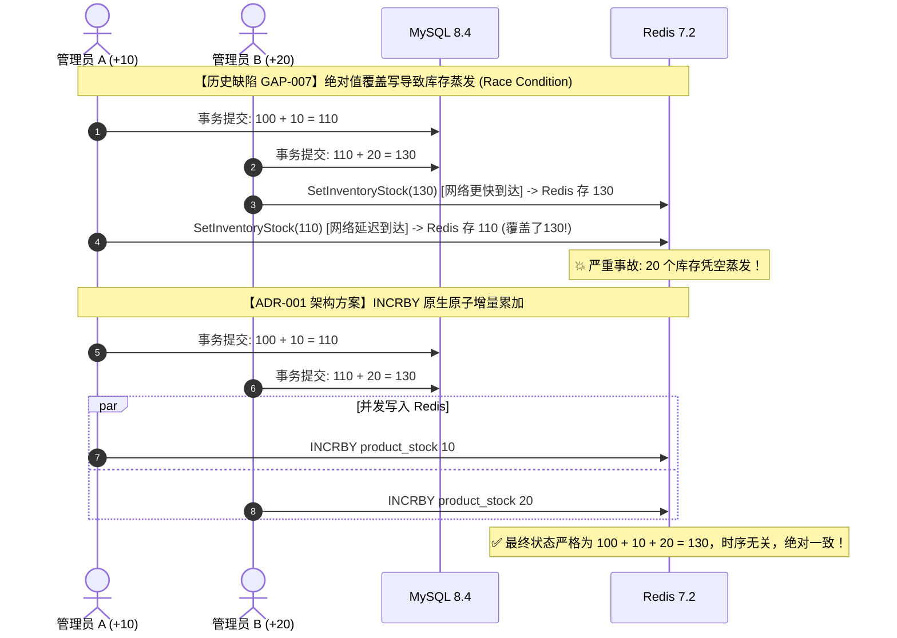

# ADR-001: 高并发低延迟与分布式最终一致性库存架构设计

- **Title**: ADR-001: 高并发低延迟与分布式最终一致性库存架构设计
- **Status**: Proposed
- **Date**: 2026-10-21
- **Deciders**: 分布式系统架构师 (`system-architect`), SRE 稳定性专家 (`sre-operator`), 后端开发专家 (`backend-dev`), 数据流工程师 (`data-engineer`)
- **Target System**: 订单与库存系统 (`go-order-management-system`)
- **Related GAPs**: GAP-001 (P1), GAP-002 (P1), GAP-005 (P1), GAP-006 (P2), GAP-007 (P0)

---

## 1. 上下文与问题陈述 (Context & Problem Statement)

### 1.1 人类开发者基准（`d5da01e`）的原始设计
在人类开发者提交的初始基准中，系统采用了经典的**单体数据库悲观事务模型**：
1. **强一致保障**：在单个 MySQL 事务中，通过 `SELECT ... FOR UPDATE` 针对 `product_inventories` 锁定行记录，校验 `stock_quantity >= quantity` 后就地执行扣减，并写入 `stock_logs`。
2. **适用范围与瓶颈**：逻辑纯粹、强一致性由 InnoDB 事务 ACID 保证。然而，在高并发秒杀或热点商品促销场景下，数据库行锁争用极其严重，连接池（默认 100）极易被耗尽，QPS 难以突破 200，P99 延迟随并发线性陡增，无法满足现代分布式高并发、低延迟的核心战略诉求。

### 1.2 AI 介入后的架构走偏与过度设计隐患
在后续由 AI 推进的提交中，系统引入了 Redis、RabbitMQ、Transactional Outbox 等分布式中间件，试图提升并发吞吐。但由于缺乏全局架构审视，出现了严重的“架构漂移”与过度并发逻辑漏洞：

1. **长事务与网络 IO 穿透（GAP-001）**：
   在 `OrderService.CreateOrder` 中，MySQL 开启本地事务后，在事务内部调用了带有 500ms 超时的外部网络 IO `preDeductInventory`（执行 Redis Lua 脚本），随后又在同一事务内执行 MySQL 的 `SELECT ... FOR UPDATE`。外部网络抖动直接拖垮 DB 连接，使毫秒级的事务被拉长数十倍。
2. **虚假的“双重扣减”**：
   同一个创建订单请求既在 Redis 中通过 Lua 执行 `DECRBY` 扣减，又在随后的 MySQL 事务内加排它锁扣减物理库存。Redis 既没有起到削峰拦截的作用，反而引入了额外的两阶段写放大。
3. **并发补货库存覆盖蒸发（GAP-007 / P0 致命缺陷）**：
   在 `InventoryService.AddInventory` 中，MySQL 事务提交计算出 `afterQuantity` 后，直接调用 `SetInventoryStock` 对 Redis 执行绝对值覆盖写（`SET key afterQuantity`）。在高并发补货场景下，由于协程调度或网络传输微小延迟，先计算的较小旧值可能在较晚时刻覆盖后计算的较大新值，导致**入库库存凭空蒸发**。
4. **分布式预占生命周期无界与恢复断裂（GAP-005 / GAP-002）**：
   Redis 预扣凭证（`reservation`）未设置超时租期（TTL）；而在极端崩溃重启场景下，超时取消逻辑因为订单状态已被标记为 `Cancelled` 而直接退出，未能幂等清理 Redis reservation 并回补库存，造成分布式库存永久泄漏。

---

## 2. 架构决策与拓扑边界 (Decision)

为了实现“**高并发、低延迟和分布式最终一致性**”的战略核心目标，对订单与库存系统做如下根本性架构重塑：

```
+-----------------------------------------------------------------------------------------+
|                                  接入层 (API Gateway / Gin)                             |
+-----------------------------------------------------------------------------------------+
                                             |
                                             v
+-----------------------------------------------------------------------------------------+
| L1 流量护城河: Redis 7.2 集群 (内存级原子预占 & 极速拦截)                                  |
|  - 前置校验: Redis Lua 原子检查库存并预扣 (DECRBY)                                       |
|  - 凭证沉淀: 生成带 TTL 的预扣凭证 reservation:{order_no}                                 |
|  - 快速失败: 库存不足返回 -1，直接响应 HTTP 400，严禁穿透至 MySQL                        |
+-----------------------------------------------------------------------------------------+
                                             | (预扣成功，进入事务)
                                             v
+-----------------------------------------------------------------------------------------+
| L2 核心事务服务: 极简本地 MySQL 事务 (无外部网络 IO, 耗时 < 5ms)                          |
|  - 纯粹写入: Insert Order, OrderItems, StockLog, Outbox (不执行外部 IO)                  |
|  - 物理库存扣减: 条件更新 UPDATE stock = stock - ? WHERE stock >= ?                     |
|  - 严禁行为: 严禁在 Begin/Commit 之间调用 Redis/MQ/HTTP                                  |
+-----------------------------------------------------------------------------------------+
                                             |
                     +-----------------------+-----------------------+
                     | 正常提交流水                                  | 异步超时检测
                     v                                               v
+------------------------------------------+    +-----------------------------------------+
| L3 持久层: MySQL 8.4 (InnoDB)            |    | L4 异步解耦: RabbitMQ 4.1 + Outbox      |
|  - 状态落盘: 订单进入 Pending / Paid     |    |  - 延迟取消: 订单 15min 超时死信队列    |
|  - 对账流水: stock_logs 完整可追溯       |    |  - 补偿闭环: 幂等释放 Redis reservation  |
+------------------------------------------+    +-----------------------------------------+
```

### 决策一：精简 MySQL 事务，Redis 预扣前置作为流量护城河（解决 GAP-001）
1. **防线外移与零 DB 穿透**：
   - 提取订单全局唯一业务号（`order_no`）生成至事务外部（UUIDv4 / Snowflake）。
   - 将 `preDeductInventory` 移至 `db.Transaction` 之前。
   - 若 Redis 预扣返回库存不足（`-1`），直接响应客户端 `ErrInsufficientStock`，**绝对不开启 MySQL 事务，零数据库连接消耗**。
2. **事务内绝对零网络 IO**：
   - 严禁在 MySQL 事务边界（`Begin` 到 `Commit`）之间发起任何外部网络调用（包含 Redis、RabbitMQ、HTTP RPC）。
   - MySQL 事务内部仅保留高效的单行数据写入与条件扣减，将数据库行锁持有时间从历史的 50ms~500ms 压缩至 3ms 以内。
3. **失败即时补偿**：
   - 若前置 Redis 预扣成功，但后续 MySQL 事务因为网络、语法或校验原因 Commit 失败，立即调用异步/同步释放逻辑（`ReleaseInventoryReservation`）将 Redis 预扣库存原子归还。

### 决策二：增量同步采用原子递增，彻底废黜绝对值覆盖（解决 GAP-007）
1. **禁止绝对值覆盖（Forbid Absolute Overwrites）**：
   - 彻底废止 `SetInventoryStock(key, afterQuantity)` 这一反模式。
2. **原子增量更新（Atomic Incremental Operations）**：
   - 补货业务（`AddInventory`）：MySQL 事务提交成功后，对 Redis 可用库存执行原生原子的 `INCRBY` 操作：
     ```
     Redis: INCRBY inventory:{stock}:available:{product_id} added_quantity
     ```
   - 采用条件 Lua 脚本防未命中穿透：若 Key 在 Redis 中不存在（缓存冷启动），则不盲目 `INCRBY` 导致生成不完整数据，而是触发异步回源重建。
   - 消除任何在应用内存中计算绝对值再回写的并发竞态，从数学拓扑上彻底消灭并发补货的时序覆盖 Bug。

### 决策三：带超时租期（TTL）的二阶段预占与幂等最终一致性（解决 GAP-005）
1. **预扣凭证租期化（Lease-based Reservation）**：
   - Redis 中的预扣凭证 `inventory:{stock}:reservation:{order_no}` 必须设置明确的 TTL（例如：订单支付超时时间 15 分钟 + 5 分钟网络漂移冗余 = 20 分钟）。
   - 结构内部记录涉及的商品 ID 及其预占数量。
2. **超时取消与幂等回补**：
   - 当收到超时取消消息或用户主动取消时，执行以下幂等闭环：
     ```lua
     -- releaseInventoryReservationScript
     local raw = redis.call("GET", KEYS[1])
     if not raw then return 0 end
     local reservation = cjson.decode(raw)
     for _, item in ipairs(reservation) do
         local stock_key = ARGV[1] .. item.product_id
         if redis.call("EXISTS", stock_key) == 1 then
             redis.call("INCRBY", stock_key, item.quantity)
         end
     end
     redis.call("DEL", KEYS[1])
     return 1
     ```
   - **状态无关的防御性释放（Defensive Release）**：即便 MySQL 中的订单因故障恢复已被置为 `Cancelled`，取消 Worker 依旧无条件尝试触发该脚本。由于脚本具备 `GET -> INCRBY -> DEL` 的原子性与幂等性（第二次调用因 Key 不存在返回 0），确保系统故障恢复后 Redis 库存绝不发生泄漏。

### 决策四：并发幂等前置防御（解决 GAP-002）
1. **前置幂等占位**：
   - 利用 Redis `SET order:idempotency:{user_id}:{idempotency_key} "PROCESSING" EX 30 NX` 进行第一道内存级并发互斥。
   - 拦截同一用户的毫秒级双击或高并发重放，直接返回 `ErrOrderBeingCreated`。
2. **解耦 MySQL RR 隔离级别下的快照盲区**：
   - 避免在 MySQL RR 隔离级别下因并发抢占唯一索引后，后到线程通过普通快照读读不到未提交记录而报 `RecordNotFound` 的异常。

---

## 3. 核心时序图 (System Interaction Sequences)

### 3.1 订单创建主链路（前置防线与极简事务）

```mermaid
sequenceDiagram
    autonumber
    actor Client as 客户端 (User)
    participant Redis as Redis 7.2 (护城河)
    participant Svc as OrderService
    participant DB as MySQL 8.4 (InnoDB)
    participant MQ as RabbitMQ 4.1

    Client->>Svc: POST /api/v1/orders (含 idempotency_key)
    Note over Svc: 生成全局唯一业务单号 order_no
    
    rect rgb(230, 245, 255)
    Note over Svc,Redis: 阶段一: L1 缓存护城河 (Redis Lua 原子预扣)
    Svc->>Redis: Eval(preDeductScript, keys, items, order_no, TTL=1200s)
    alt 库存不足 (Result == -1)
        Redis-->>Svc: -1 (Insufficient)
        Svc-->>Client: 400 Bad Request (库存不足，零DB压力)
    else 预扣成功 (Result == 1)
        Redis-->>Svc: 1 (Reserved, 生成 reservation:{order_no})
    end
    end

    rect rgb(255, 245, 230)
    Note over Svc,DB: 阶段二: L2 极简数据库事务 (耗时 < 5ms, 零外部网络 IO)
    Svc->>DB: Begin Transaction
    Svc->>DB: INSERT INTO orders (order_no, status=Pending)
    Svc->>DB: INSERT INTO order_items (...)
    Svc->>DB: UPDATE product_inventories SET stock_quantity = stock_quantity - ?
    Svc->>DB: INSERT INTO stock_logs (...)
    Svc->>DB: INSERT INTO order_timeout_outbox (...)
    Svc->>DB: Commit Transaction
    end

    alt 数据库事务异常 (Commit Failed / Panic)
        Svc->>Redis: Eval(releaseReservationScript, reservation:{order_no})
        Note over Redis: 异步或同步极速回滚预扣库存
        Svc-->>Client: 500 Internal Error (已安全回滚)
    else 数据库提交成功
        Svc-->>Client: 201 Created (返回订单详情与待支付凭证)
        Svc-)-MQ: 异步/Outbox发布延迟关单消息 (15分钟)
    end
```

### 3.2 补货链路并发对比：错误覆盖写 vs 原生原子增量（GAP-007）



---

## 4. 单点故障 (SPOF) 与并发竞态识别

| 潜在风险点 / 竞态场景 | 严重级别 | 影响表现 | 容灾、降级与治理策略 |
| :--- | :---: | :--- | :--- |
| **SPOF-1: Redis 集群瞬断或宕机** | 高危 | 预扣脚本执行超时或返回网络错误，主链路受阻 | **熔断降级策略**：通过 Sentinel/Cluster 自动主从切换；应用层集成 Hystrix 模式降级开关：当 Redis 连续超时达到阈值时，自动平滑降级为人类基准模式（MySQL 行锁条件扣减），牺牲部分吞吐保障高可用。 |
| **SPOF-2: RabbitMQ 积压或停机** | 中危 | 延迟超时消息丢失，超时订单无法关单释放库存 | **双重保险**：依托 `order_timeout_outbox` 关系表，后台常驻 Outbox 轮询补偿 Worker（采用 `FOR UPDATE SKIP LOCKED`），在 MQ 宕机期间接管超时关单扫描。 |
| **RACE-1: 支付成功与超时取消并发到达** | 高危 | 用户恰在第 15 分钟完成支付，但取消 Worker 同时在回滚库存与置订单为 Cancelled | **状态机 CAS 强校验**：订单状态流转采用条件更新：`UPDATE orders SET status = 'Paid' WHERE id = ? AND status = 'Pending'`。若更新行数为 0，说明已被超时取消，立即触发退款流，绝不允许状态逆向覆盖。 |
| **RACE-2: 缓存冷启动/穿透** | 中危 | 未初始化的商品 ID 收到高并发请求，Redis 未命中穿透至 DB | **Singleflight 保护 + 空值占位**：对 Redis 未命中的查询采用 Singleflight 抑制瞬时并发回源，DB 不存在时在 Redis 中写入空对象（TTL 30s），防止非法流量打崩数据库。 |

---

## 5. 收益、代价与权衡 (Consequences & Trade-offs)

### 5.1 收益 (Benefits)
1. **超高吞吐与极低延迟（Low Latency）**：
   - 95% 以上的超卖请求在 L1 缓存层（Redis）被毫秒级拦截（耗时 < 1ms），完全不接触数据库。
   - MySQL 事务内剔除外部网络 IO，核心事务从历史的 100ms+ 降低至 3~5ms，连接池并发承载能力提升 10 倍以上。
2. **彻底消灭数据一致性死角**：
   - 根除 GAP-007：原子 `INCRBY` 消除时序覆盖，保证补货增量与 MySQL 严格一致。
   - 根除 GAP-005：带 TTL 的 Reservation 凭证与幂等释放脚本，保证无论系统发生任何崩溃重启，预占库存终将释放。

### 5.2 代价与工程复杂度 (Trade-offs)
1. **一致性模型由 ACID 转向 BASE**：
   - 系统由强一致性转变为基于补偿与重试的分布式最终一致性（Eventual Consistency）。
   - 研发人员需要理解二阶段预占、Lua 原子性边界以及对账兜底逻辑。
2. **运维与可观测性要求提升**：
   - 必须对 Redis 内存占用、Lua 脚本耗时（P99）、RabbitMQ 死信积压建立 Prometheus 告警矩阵与实时指标看板。

---

## 6. 验收标准 (Acceptance Criteria - Given-When-Then)

### 6.1 场景一：并发补货防库存回退与蒸发 (针对 GAP-007)
```gherkin
Scenario: 50个并发补货请求，验证原子增量无时序覆盖
  Given 商品 ID 为 101 的商品，当前在 MySQL 与 Redis 中的物理库存均为 100 件
  When 50 个管理端请求同时并发调用 AddInventory，每个请求增加 2 件库存（预期总计增补 100 件）
  Then 所有 50 个请求均成功返回 HTTP 200
  And MySQL 中的 stock_quantity 严格等于 200
  And Redis 中的可用库存键严格等于 200，无任何由于网络乱序写覆盖导致的库存蒸发
  And stock_logs 记录 50 条补货流水，增量总和为 100
```

### 6.2 场景二：秒杀流量前置拦截与零长事务 (针对 GAP-001)
```gherkin
Scenario: 热点秒杀库存售罄，Redis 前置拦截无效流量不透传 MySQL
  Given 商品 ID 为 202 的秒杀商品，在 Redis 与 MySQL 中的库存仅剩 5 件
  When 100 个并发用户同时发起购买请求（每人抢购 1 件）
  Then 恰好 5 个请求通过 Redis 预扣并进入 MySQL 事务成功创建订单
  And 另外 95 个请求在 Redis 预扣阶段被立即拦截，返回 ErrInsufficientStock (HTTP 400)
  And 该 95 个失败请求绝对没有在 MySQL 中开启任何事务，没有发生任何行锁争用与数据库连接耗尽
  And MySQL 数据库的慢查询日志（Slow SQL > 100ms）数量为 0
```

### 6.3 场景三：崩溃恢复与超时关单下的最终一致性回补 (针对 GAP-005)
```gherkin
Scenario: 订单超时关单，即便服务故障重启，Redis 预扣库存依然幂等归还
  Given 用户创建订单成功，Redis 中扣减 2 件并生成 reservation:ORDER_TEST_001
  And 订单未在 15 分钟内完成支付
  When 取消 Worker 消费超时消息，但在执行过程中模拟发生网络瞬断或节点重启
  And 重启后再次拉取到相同订单的取消消息并重试执行
  Then 订单状态在 MySQL 中确认为 Cancelled
  And Redis 中的对应 reservation 凭证被删除
  And Redis 中的可用物理库存被精确回补 2 件，且仅回补一次，绝无重复回补现象
```
